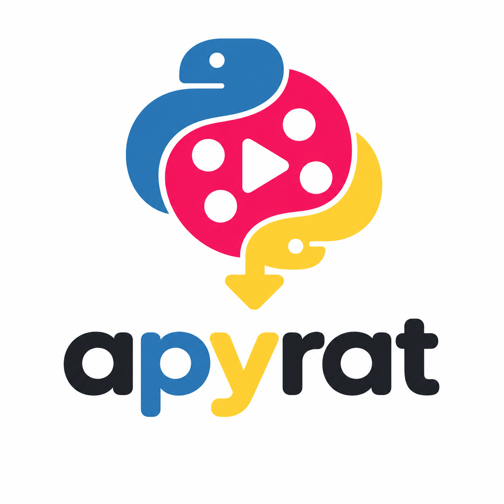

<div align="center">



# Apyrat

**Download [Aparat](https://www.aparat.com) videos and playlists from your terminal.**

[](https://pypi.org/project/apyrat/)
[](https://pypi.org/project/apyrat/)
[](https://github.com/CodeWithEmad/apyrat/actions/workflows/test.yml)
[](https://pepy.tech/projects/apyrat)
[](https://github.com/CodeWithEmad/apyrat/blob/master/LICENSE)


</div>

## Install

```bash
pipx install apyrat        # recommended: isolated, always on your PATH
# or
uv tool install apyrat
# or
pip install -U apyrat
```

Requires Python 3.10+.

## Usage

```bash
# a single video: pick a quality interactively
apyrat https://www.aparat.com/v/qur3I

# skip the prompt: 720p, or the best available if missing
apyrat -y https://www.aparat.com/v/qur3I

# an exact quality, with your own filename
apyrat -q 1080p -f lecture https://www.aparat.com/v/qur3I

# a whole playlist, in playlist order
apyrat -y https://www.aparat.com/playlist/448747
```

### Options

| Option | Description |
| --- | --- |
| `-q, --quality` | Quality to download, e.g. `480p`, `720p`, `1080p`. Prompts if it isn't available. |
| `-y, --confirm` | Don't prompt: use 720p, or the highest available quality if 720p is missing. |
| `-f, --filename` | Output filename (single videos only; the extension is added for you). |
| `-v, --version` | Show the version and exit. |
| `-h, --help` | Show help and exit. |

### Good to know

- Files are saved in the current directory, named after the video title. Persian
  titles work; characters that filesystems reject are removed.
- If a file with the same name already exists, a short hash is prefixed to the
  new one instead of overwriting it.
- Supported links: `aparat.com/v/<id>` and `aparat.com/playlist/<id>`.

## Contributing

Bug reports and pull requests are welcome. See [CONTRIBUTING.md](https://github.com/CodeWithEmad/apyrat/blob/master/CONTRIBUTING.md)
for the dev setup (`make install`, `make test`) and the release process.

## License

[MIT](https://github.com/CodeWithEmad/apyrat/blob/master/LICENSE)
